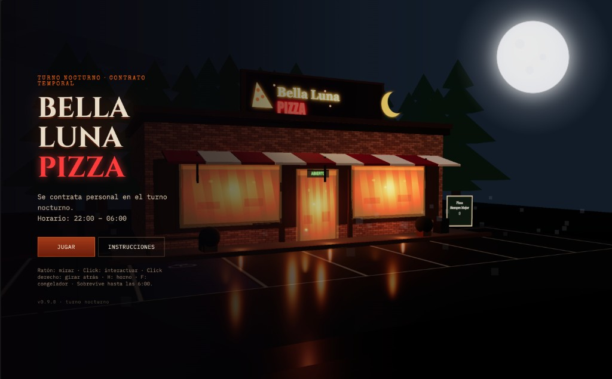
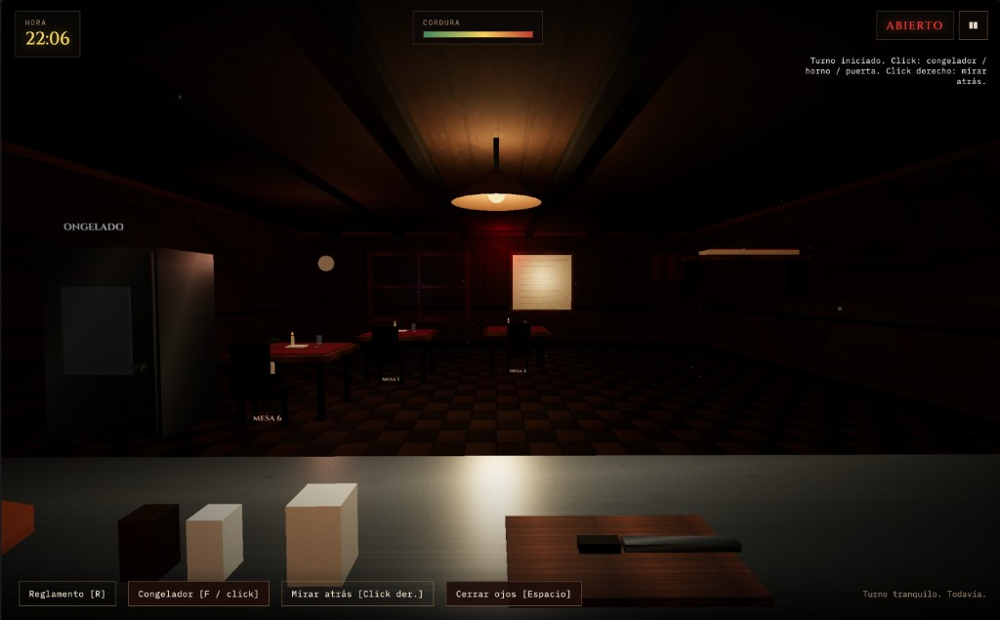
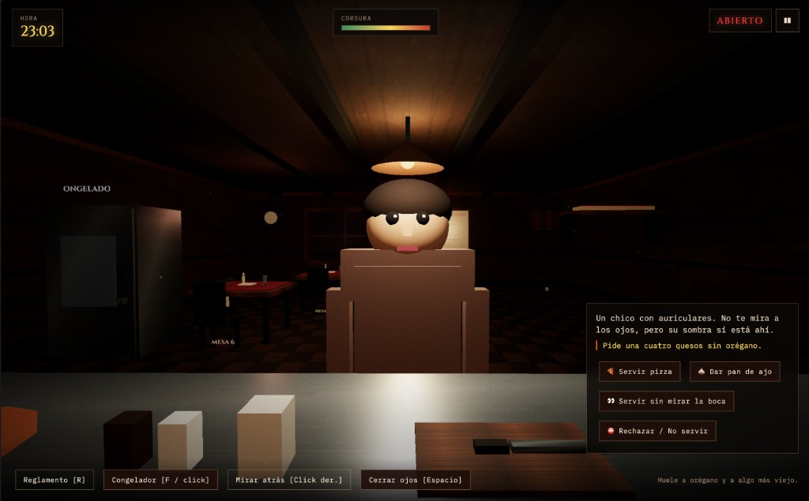
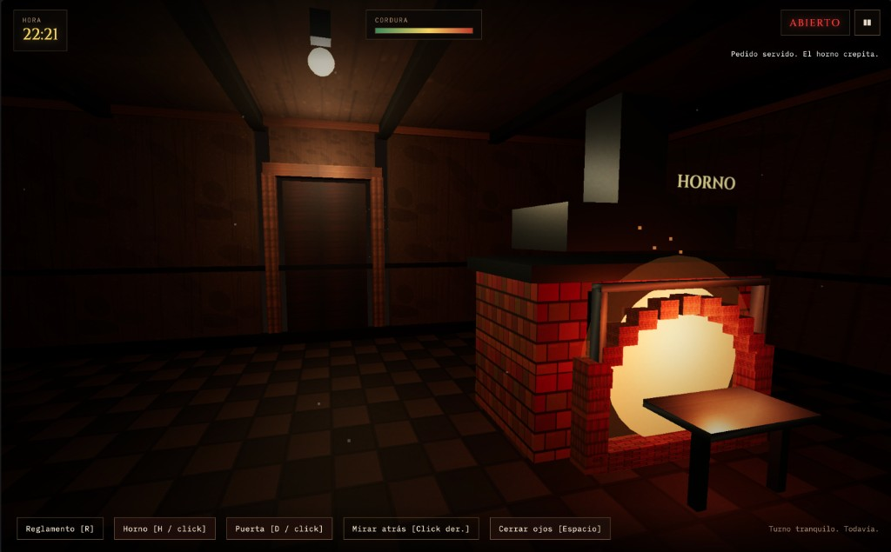

<p align="center">
  
</p>

<h1 align="center">Bella Luna Pizza</h1>

<p align="center">
  <strong>Turno nocturno · Contrato temporal</strong><br />
  Juego web de terror procedural: sobrevive de las 22:00 a las 06:00<br />
  en una pizzería donde las reglas importan más que la pizza.
</p>

<p align="center">
  <a href="https://bella-luna-pizza.nightowlstudio.workers.dev/"><strong>▶ Jugar gratis</strong></a> ·
  <a href="#demostración">Demostración</a> ·
  <a href="#cómo-jugar">Cómo jugar</a> ·
  <a href="#controles">Controles</a> ·
  <a href="#reglamento">Reglamento</a> ·
  <a href="#mecánicas">Mecánicas</a>
</p>

<p align="center">
  <a href="https://bella-luna-pizza.nightowlstudio.workers.dev/">https://bella-luna-pizza.nightowlstudio.workers.dev/</a>
</p>

---

## Sobre el juego

Trabajas el turno de noche en **Bella Luna Pizza**. La dueña no está. El horno no debe apagarse. Los clientes llegan… y no todos son humanos.

Es un survival horror en primera persona, ligero y jugable en el navegador: atiendes pedidos, vigilas el local y cumples el **reglamento**. Si lo rompes, el turno termina mal.

- **Duración:** ~4–5 minutos reales (turno de 22:00 → 06:00)
- **Género:** horror / reglas / atención
- **Plataforma:** navegador (HTML · CSS · JavaScript · Three.js)
- **Idioma:** español
- **Versión:** v0.9.8
- **Jugar gratis:** [bella-luna-pizza.nightowlstudio.workers.dev](https://bella-luna-pizza.nightowlstudio.workers.dev/)

Inspirado en juegos de “sigue las reglas” (tipo *No, I’m not a Human*, *Iron Lung* atmosférico, etc.), pero con sabor a pizzería de barrio a las tres de la madrugada.

---

## Demostración

Capturas del turno nocturno en Bella Luna Pizza:

<p align="center">
  <br />
  <em>Menú principal — turno nocturno · contrato temporal</em>
</p>

<p align="center">
  <br />
  <em>Vista del mostrador — HORA, CORDURA y el local en silencio</em>
</p>

<p align="center">
  <br />
  <em>Cliente en el mostrador — decide si servir, rechazar o seguir la regla correcta</em>
</p>

<p align="center">
  <br />
  <em>Cocina / horno — el fuego no debe apagarse</em>
</p>

---

## Cómo jugar

### Probar online (gratis)

Abre el juego en el navegador:

**[https://bella-luna-pizza.nightowlstudio.workers.dev/](https://bella-luna-pizza.nightowlstudio.workers.dev/)**

No requiere instalación.

### Requisitos

- Navegador moderno con soporte de **ES modules** y **WebGL** (Chrome, Firefox, Safari, Edge actuales)
- Un servidor HTTP local (los módulos ES no cargan bien abriendo el archivo a pelo con `file://`)

### Ejecutar en local

```bash
git clone https://github.com/LewisAngelo11/bella-luna-pizza.git
cd bella-luna-pizza
python3 -m http.server 8080
```

Abre [http://localhost:8080](http://localhost:8080).

También vale cualquier servidor estático (`npx serve`, Live Server de VS Code/Cursor, etc.).

### Flujo de partida

1. Lee la carta de la dueña y las instrucciones.
2. Empieza el turno a las **22:00**.
3. Atiende clientes, responde al teléfono y reacciona a eventos del local.
4. Consulta el reglamento con **R** cuando lo necesites.
5. Sobrevive hasta las **06:00** para cobrar… y vivir.

---

## Controles

| Entrada | Acción |
|---|---|
| Mover el **ratón** | Mirar alrededor (cámara 3D) |
| **Click izquierdo** | Interactuar con congelador / horno / puerta |
| **Click derecho** | Girar: comedor ↔ cocina / puerta trasera |
| **F** | Abrir / cerrar congelador *(solo mirando al comedor)* |
| **H** | Encender / apagar horno *(solo mirando atrás)* |
| **D** | Abrir / cerrar cerrojo de la puerta trasera *(solo mirando atrás)* |
| **Espacio** (mantener) | Cerrar los ojos |
| **R** | Abrir / cerrar el reglamento |
| **Esc** | Pausar / reanudar |
| Botones del HUD | Clientes, teléfono, menús |

---

## Reglamento

El reglamento está en el juego (`js/rules.js`) y en el cajón del mostrador. **No son sugerencias.**

1. Si un cliente **no proyecta sombra**, no le sirvas. Ni le hables.
2. **Nunca** sirvas piña después de las **00:00**. Aunque lo pidan amablemente.
3. El **congelador** permanece cerrado. Si oyes golpes desde dentro: **ignóralos**.
4. No mires la **Mesa 6** más de **tres segundos** seguidos.
5. Si el **teléfono** suena **dos** veces, contesta. Si suena **tres**, cuelga al instante.
6. Clientes con **ojos rojos** reciben **pan de ajo**. Nunca pizza.
7. Si alguien dice «**el gerente me mandó**», miente. Recházalo.
8. Cuando **parpadeen las luces**, cierra los ojos hasta que se estabilicen.
9. Si un cliente sonríe con **demasiados dientes**, no mires su boca. Sirve y aparta la vista.
10. Después de las **02:00**, la **puerta trasera** debe permanecer cerrada con llave. Si se abre, ciérrala de inmediato.
11. El **horno** no debe apagarse. Si se apaga solo, enciéndelo de inmediato.
12. Si el **congelador se abre solo**, puede cerrarse solo… o no. Si no lo hace, ciérralo tú antes de **cinco segundos**.

> «Si algo se siente mal, probablemente lo esté.» — Señorita Luna

---

## Mecánicas

### Objetivo

Llegar a las **06:00** sin morir. Cada error grave puede acabar el turno al instante; errores menores suben el medidor de **cordura / miedo**.

### Clientes

Hay dos tipos:

| Tipo | Qué hacer |
|---|---|
| **Normales** | Servir pizza (pedido habitual) |
| **Anomalías** | Aplicar la regla correcta: rechazar, pan de ajo, servir sin mirar la boca, etc. |

Acciones disponibles en el mostrador:

- Servir pizza  
- Dar pan de ajo  
- Servir sin mirar la boca  
- Rechazar / no servir  

Una anomalía mal atendida suele ser **muerte instantánea**. Un cliente normal mal atendido castiga la cordura.

### Local y eventos

Mientras atiendes, el local “vive”:

| Sistema | Qué pasa | Cómo responder |
|---|---|---|
| **Luces** | Parpadean | Mantén **Espacio** (ojos cerrados) hasta que paren |
| **Horno** | Puede apagarse solo | Gira atrás y enciéndelo (**H** / click) antes de que se enfríe del todo |
| **Congelador** | Golpes desde dentro | **No abras** |
| **Congelador** | Se abre solo | Puede cerrarse solo; si no, ciérralo tú a tiempo (**F**) |
| **Puerta trasera** | Tras las 02:00 puede abrirse sola | Ciérrala / echa el cerrojo (**D**) enseguida |
| **Teléfono** | 1 → 2 → 3 timbres | 2 = contestar · 3 = colgar |
| **Mesa 6** | Mirarla demasiado | Aparta la vista antes de 3 s |

### Curva horaria

El reloj del juego avanza de **22:00 a 06:00**. La noche no es uniforme:

| Hora | Ambiente |
|---|---|
| **22:00 – 23:00** | Hora calmada: solo clientes normales. Sin rarezas ambientales (sin parpadeos, sin que el horno/congelador “actúen solos”). |
| **23:00 – 03:00** | Noche mixta: normales y anomalías; eventos del local con ritmo habitual. |
| **03:00 – 04:00** | Las tres: **solo anomalías**, clientes más seguidos, y mucha más presión (más parpadeos, congelador, apagones de horno y puerta trasera). |
| **04:00 – 06:00** | Madrugada: sigue peligrosa, pero sin el pico de las tres. |
| **06:00** | Fin del turno. Victoria. |

### Cordura

El HUD muestra un medidor (cordura vs miedo). Acertar baja la tensión; fallar la sube. Si llega al límite, el turno se rompe.

---

## Stack técnico

| Pieza | Uso |
|---|---|
| **HTML / CSS** | UI, menús, overlays, HUD |
| **JavaScript (ES modules)** | Lógica de juego, reglas, loop |
| **Three.js** (`vendor/three.module.js`) | Escena 3D, luces, entidades |
| **Web Audio API** | Sonido procedural (sin assets de audio externos) |

Sin bundler ni framework: clona, sirve estático y listo.

---

## Estructura del proyecto

```text
bella-luna-pizza/
├── index.html              # Entrada + pantallas UI
├── css/style.css           # Estilos
├── assets/                 # Iconos, favicon y capturas de demostración
├── vendor/three.module.js  # Three.js vendoreado
├── js/
│   ├── main.js             # Boot
│   ├── game.js             # Loop, turno, eventos, clientes
│   ├── rules.js            # Reglamento, clientes, anomalías, muertes
│   ├── audio.js            # Motor de audio procedural
│   ├── renderer.js         # Facade del renderer
│   ├── menu/MenuScene.js   # Menú 3D de fondo
│   └── render/             # Escena, luces, entidades 3D
└── README.md
```

Puntos de interés para contribuir:

- **`js/rules.js`** — texto de reglas, plantillas de clientes y anomalías  
- **`js/game.js`** — spawn, timers, curva horaria, win/lose  
- **`js/render/entities/`** — props del local (horno, puerta, clientes, etc.)  
- **`js/audio.js`** — timbres, golpes, ambiente  

---

## Contribuir

El proyecto es **open source** y acepta mejoras. Ideas bienvenidas:

- Nuevas anomalías / reglas (sin romper el balance de la noche)
- Ajustes de dificultad o feedback UX
- Accesibilidad (subtítulos de eventos, opciones de sensibilidad)
- Localización a otros idiomas
- Pulido visual / performance WebGL
- Tests de lógica pura (spawn, reglas, ventanas horarias)

Flujo sugerido:

1. Fork del repo  
2. Rama descriptiva (`feat/...`, `fix/...`)  
3. Prueba en local con un servidor estático  
4. Pull request con descripción clara (qué cambia y por qué)

Mantén el tono del juego (español, horror contenido, sin spoilers innecesarios en el código público si se puede evitar).

---

## Licencia

Proyecto pensado para publicarse como **open source**.

Si aún no hay archivo `LICENSE` en la raíz, añade uno al publicar (por ejemplo **MIT** o **GPL-3.0**) y actualiza esta sección para citarlo explícitamente.

---

## Créditos

- **Juego / código:** Bella Luna Pizza  
- **Render:** [Three.js](https://threejs.org/)  
- **Fuentes:** Cinzel, IBM Plex Mono, Special Elite (Google Fonts)  
- **Sonido:** Web Audio API (síntesis procedural)

---

<p align="center">
  <em>Confía en las reglas, no en lo que vean tus ojos.</em><br />
  — Señorita Luna
</p>
